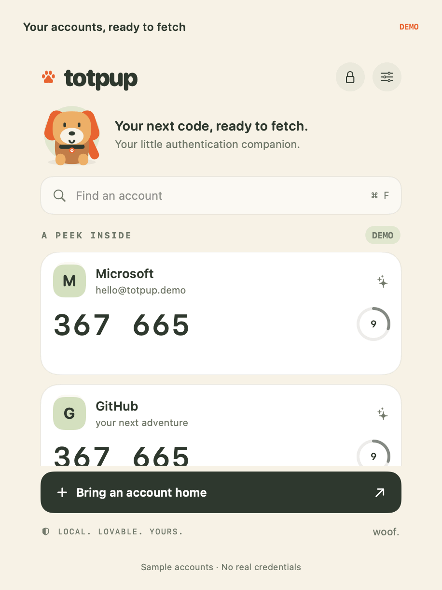
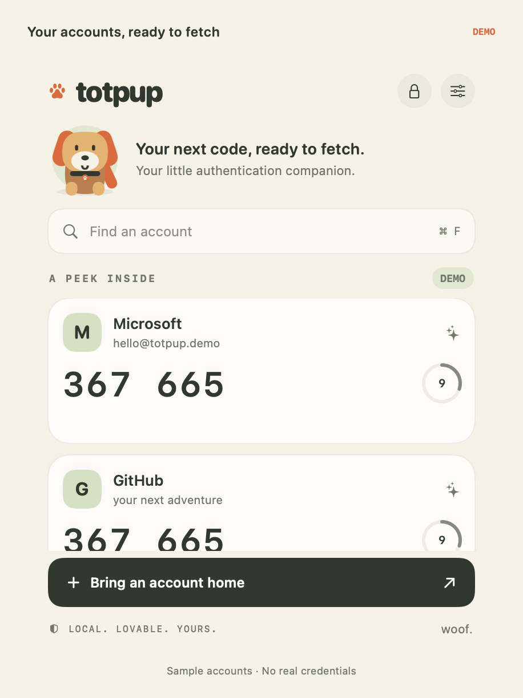
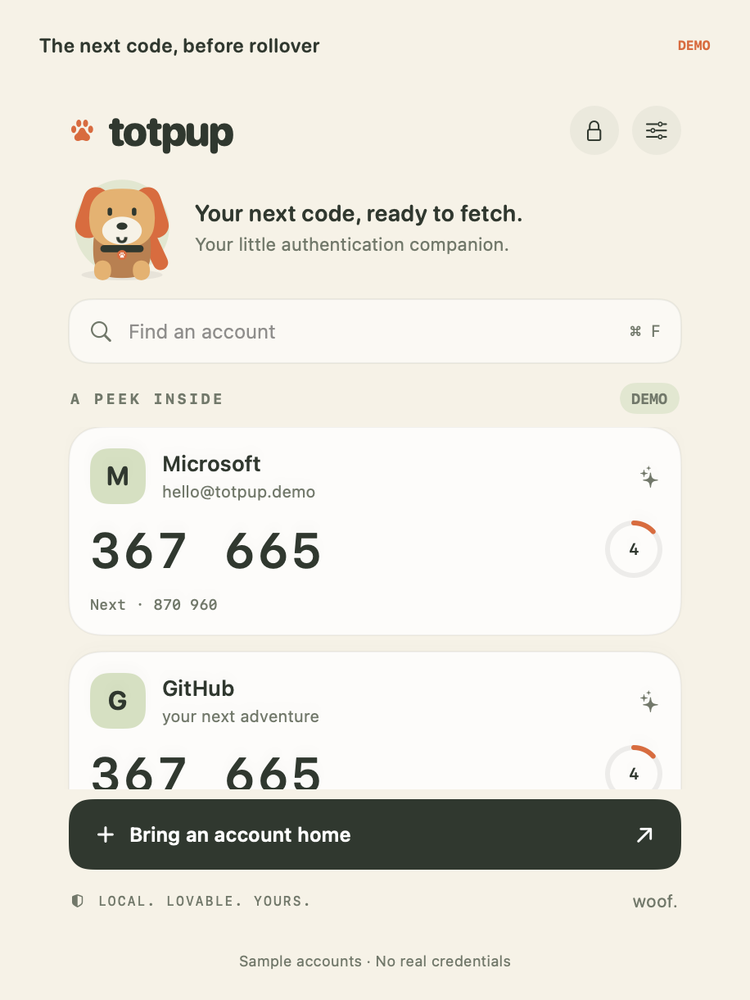
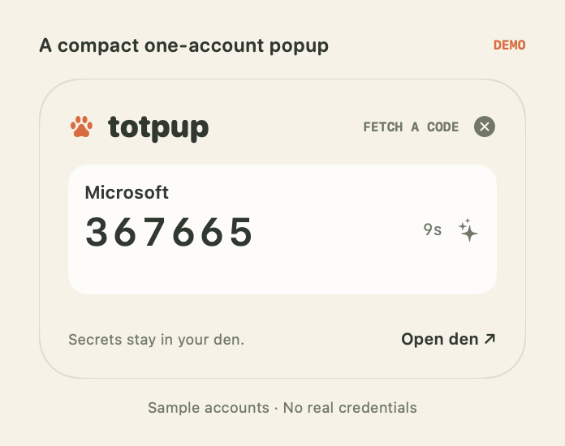
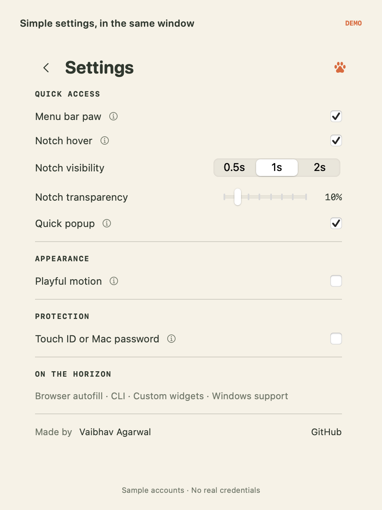
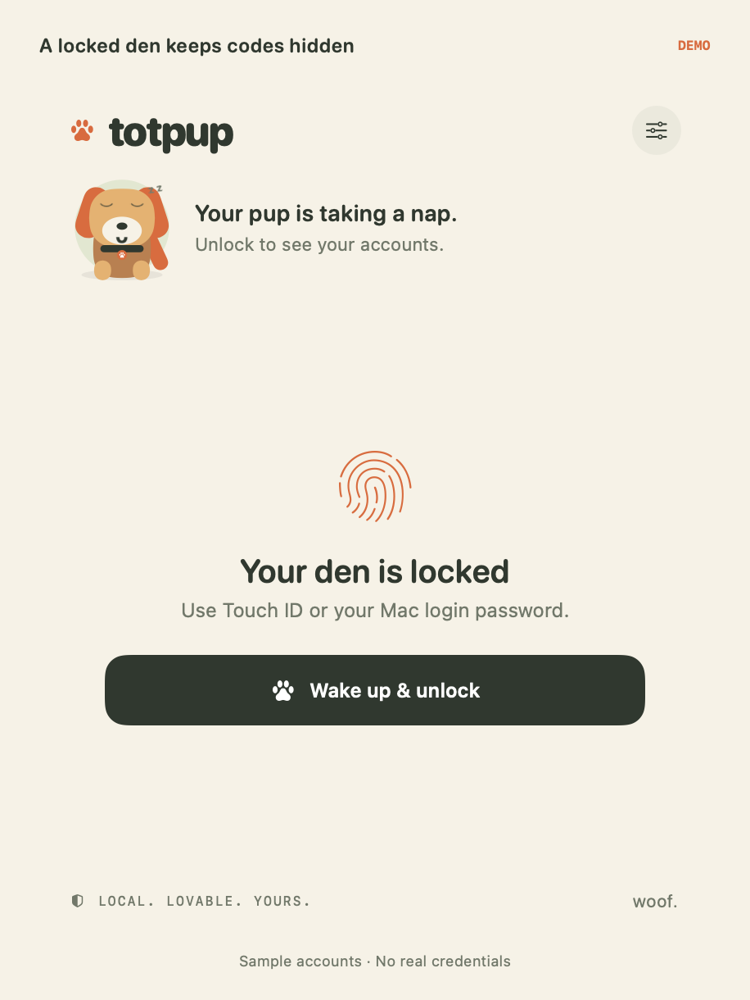

# totpup

Your little authentication companion. Fetch TOTP codes from a compact Mac app, the menu bar, or a quick notch peek.

## See Totpup in action



*Animated walkthrough rendered from the actual app views with sample accounts and a simulated clock. No real enrollment secrets or account data appear. This illustrates UI states; it is not a recording of a real account login.*

### Screenshots

| Accounts and countdown | Upcoming code preview |
| --- | --- |
|  |  |

| Compact popup | Inline settings | Locked vault |
| --- | --- | --- |
|  |  |  |

**What to try:** open the menu bar paw, click a code to copy, watch the Next preview before rollover, and set notch visibility/transparency. Native desktop and Notification Center tiles currently open the popup; they do not display codes inline.

[Demo walkthrough and media regeneration instructions](docs/DEMO.md)

## Current implementation — 0.3.5

A compact account window with inline settings, a menu bar paw, notch hover panel, draggable popup, and native launcher tiles. The solid **Biscuit** theme is used throughout; detailed help appears in hover tooltips. Only working controls are shown. Notch visibility is 0.5, 1, or 2 seconds with fixed segmented choices. The previous native code-widget experiment and its cache writer are removed; the Keychain recovery history remains in `KEYCHAIN-AUDIT.md`.

Your little authentication companion. A native macOS TOTP app with a warm pup mascot, live countdowns, QR image import, and a local Keychain vault.

## Run

Requires macOS 14+ and Swift 6-capable Command Line Tools. No Apple Account, full Xcode installation, or developer signing team is required to build the current local prototype.

```sh
swift run Totpup
```

To make a local app bundle:

```sh
zsh scripts/build-app.sh
```

Open `dist/Totpup.app` in Finder. The bundle is locally signed for development; distribution requires proper signing and notarization. Quit through the application menu or Command-Q.

## Share with a coworker

The recommended development handoff is the source project. Your coworker needs a Mac running macOS 14 or later and a Swift 6-capable toolchain. The current launcher-widget build supports Command Line Tools; full Xcode and an Apple Account are not required for this build. The scripts target the recipient’s Mac architecture. Intel builds require a compatible toolchain and have not been validated on an Intel Mac.

After the project is on GitHub, they can run:

```sh
xcode-select --install
git clone https://github.com/avaibhav51/totpup.git
cd totpup
swift --version
zsh scripts/build-app.sh debug
zsh scripts/register-widgets.sh
open dist/Totpup.app
```

If Command Line Tools are already installed, skip the first command. Registration uses the app's current path; keep the app there while using its widgets. If they move the app, register the extension at its new location. Each person enrolls their own TOTP accounts: cloning source does not transfer your Keychain or account secrets. The current native tiles are launchers, as described above.

Alternatively, share a zipped app bundle built for the same architecture as their Mac. From this project directory:

```sh
ditto -c -k --sequesterRsrc --keepParent dist/Totpup.app dist/Totpup-mac.zip
```

They extract the ZIP and open Totpup. This local build is not Developer ID signed or notarized, so macOS or organization policy may block it. If their policy permits this development build, Apple's [Open Anyway procedure](https://support.apple.com/en-gb/102445) can authorize that specific app. The source-build route is preferable for this prototype. A normal public release should be signed and notarized by the publisher.

## First account

Choose **Bring an account home**. Paste a Base32 secret or a standard `otpauth://totp/…` enrollment URI, or import an image containing one enrollment QR. Enter the service and account names, then save. During the final four seconds, a small Next preview fades in on account cards, the popup, and notch panel. It shows the following period’s code; clicking continues to copy only the currently valid code. Codes support SHA-1, SHA-256 and SHA-512, 6–8 digits, and configurable periods carried by setup URIs. Sample cards are clearly marked demo and can be copied to try the clipboard interaction; their codes are not valid for real accounts. Clipboard writes are checked before showing copy feedback.

Organization accounts work when they provide compatible TOTP enrollment and permit third-party authenticators. The Microsoft and GitHub demo cards are illustrative sample accounts, not native provider integrations. Proprietary activation QR codes, push approval, and number matching are not supported. Existing phone enrollment does not automatically expose its secret to Totpup. Don't reset organization MFA without a supported re-enrollment plan.

## Presentation and motion

The main den is a single window. Opening it repeatedly or clicking its Dock icon brings that same window forward. Closing the window leaves quick access running; Command-Q quits the app.

Quick access settings are independent toggles:

- **Menu bar icon:** the paw beside the clock opens the same movable code popup as the shortcut. Right-click it for Open Totpup and Quit.
- **Notch hover:** hovering immediately below the notch slides down a separate code panel. Settings let you choose 0.5, 1, or 2 seconds (default 1). It stays open while the pointer is inside it. One unlocked saved account uses a compact 300×185 panel; multiple accounts, demo cards, and the locked view use 360×270. Settings offers 0–70% notch background transparency (default 10%, preserving saved preferences); foreground codes remain opaque and Reduce Transparency keeps the background solid. Macs without a notch use the top center edge. Mouse-position polling uses public AppKit APIs and does not require screen recording or Accessibility permission.
- **Quick popup:** Control + Option + P and the menu bar paw open the same adaptive panel: 300×185 for one unlocked saved account, otherwise 360×270. The panel resizes when account/lock state changes, retaining its top-left placement within the screen. Drag its header to move it; the position is retained on reopening and saved across launches. Click outside or press Escape to dismiss it. This shortcut uses Carbon hotkey registration; conflicting shortcuts are reported in the app.

The app bundle embeds a **WidgetKit extension** with small and medium launcher tiles on the desktop and in Notification Center. Add **Totpup** through macOS **Edit Widgets**. **Fetch a code** opens the live popup. The installed tiles do not display account codes, offer account configuration, or access Keychain.

### Next step: custom desktop widgets

Implement a small custom desktop tile first, then a wider tile. These are titleless AppKit panels with a persistent desktop presence; they are not native Edit Widgets or Notification Center code widgets.

- Small: choose one account, mask its code by default, and reveal inline for a configurable 1–8 seconds.
- Wide: masked accounts with independent reveal actions and a layout that does not crop rows.
- Live TOTP countdown, remembered placement, and no Dock icon while only desktop tiles or the notch are active.
- Use the existing app vault and authentication flow in the same process. No shared-Keychain bridge, enrollment-secret exports, or repeated authorization requests.
- Re-mask on the earlier of reveal timeout and code expiry; define lock, sleep, authentication cancellation, account removal, and relaunch behavior before shipping.
- Build with the current Command Line Tools workflow. No full Xcode installation, Apple Account, or developer signing team is planned for this local custom-panel approach.

The current native launcher tiles remain usable. Native inline code widgets are outside the active roadmap; the failed experiments have been deleted. The custom code panels above are a planned feature and have no inactive controls in the current app.

The app runs as a background accessory after its main window and popup close. Opening either restores its Dock icon; the notch alone does not. Settings replace the account content inside the same window; Back returns to accounts. Detailed explanations use hover tooltips. The menu bar paw uses an explicit AppKit status item and can be recreated with **Refresh menu bar icon**. macOS can hide status items when the menu bar has insufficient space even while they are enabled.

The pup briefly bobs on arrival, reacts when a code is fetched, and naps while locked. Cards animate code changes, countdown rings and hover feedback. The app uses the solid Biscuit theme. Disable playful motion in settings; system Reduce Motion is respected. The theme uses a light foreground style.

## Storage and access

Account metadata and secrets are stored separately in non-synchronizing, device-only Keychain items. The service name is `app.totpup.authenticator`: the item account `accounts` contains encoded account metadata, and each account UUID identifies a separate item containing its Base32 TOTP secret. With the current non-synchronizing SecItem queries and no data-protection-keychain opt-in, this uses the macOS file-based Keychain, normally the user’s login Keychain. UI preferences such as notch duration/transparency are stored separately in UserDefaults under the app bundle domain; no enrollment secrets are written there. Secrets are loaded into memory while the vault is open. Locking clears the application's secret cache. Optional local authentication uses Touch ID or the Mac login password; it locks after two minutes without an account action, on sleep, and at next launch. This is application-level access gating, not a separate biometric ACL on every Keychain item. Clipboard codes clear after 20 seconds if the clipboard has not subsequently changed.

## Architecture and roadmap

`TotpCore` isolates enrollment parsing, account configuration and TOTP generation from the UI. `Vault` supplies macOS storage and access behavior. SwiftUI and AppKit supply the Mac surfaces. Windows is the next intended platform, with platform-specific storage and UI; the current Swift/CryptoKit core is not promised as a Windows-ready binary. Standard enrollment formats and reference vectors provide a portable behavior contract.

Next: browser autofill, CLI commands, custom desktop widgets, and Windows support. The current native launcher widgets remain in place. Phone apps and cross-device sync are deferred.

## Verify

```sh
swift run OTPVerify
```

The dependency-free verifier covers all 18 RFC 6238 reference values, enrollment validation and period boundaries, and works with Command Line Tools without XCTest. Keychain, local authentication and GUI behavior need manual validation in the app.

The packaged app also has a demo-only live startup regression check:

```sh
dist/Totpup.app/Contents/MacOS/Totpup --check-startup
```

This runs the real SwiftUI scene/event loop, removes and reinserts the menu bar item, checks that reopening keeps one main window, checks popup/notch panel reuse, and exits after about five seconds. It uses demo accounts and doesn't read saved secrets. Icon generation asserts that all four corners have zero alpha.
